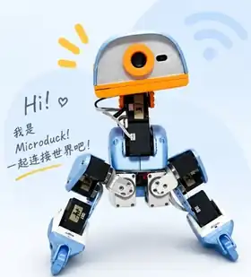
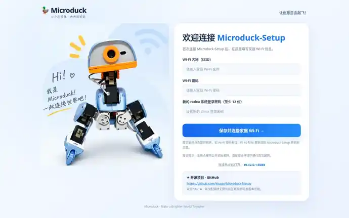

# 🦆 Microduck · 让桌面上的小鸭动起来

### 刷好镜像，连上 Wi-Fi，打开中控。简单一点，好玩很多。

**基于官方 Microduck 0.15.1 · 飞特 HD1910 适配 · 两套中文中控**

**即将更新：机器人中控 R17 V164 · 固件 control.40 · 训练中控 R1.5.27**

[🎮 机器人中控在线演示](https://kissqy.github.io/Microduck-kissqy/) · [🧠 训练中控在线演示](https://kissqy.github.io/Microduck-kissqy/training/)

> 📣 **新版固件和源码将于近日更新！** 目前先开放项目介绍、实机视频和在线演示；完整镜像、R17 V164、训练中控 R1.5.27 的新版下载资料正在整理中。**页面先行，不代表新固件已发布。**

---

## ✨ 不用从零配置一堆软件

这是一只会**走路、坐下、捡东西、踢球、前滚翻**的小鸭。装上滑轮，还能探索**对称滑行、蹲下、原地转和倒地起身**等动作。实体手柄就能控制，不必为了每个动作打开电脑点按钮；想训练自己的动作，还有独立训练中控。

**计划提供一张整合镜像**，把官方系统和本项目机器人服务预装在一起。镜像发布后，刷入 Radxa ZERO 3W、连接 Wi-Fi，再打开中文中控即可开始体验，无须从源码编译固件。

## 🚀 三步开始（新版镜像发布后）

1. **刷镜像** — 从届时发布的下载页取得官方 `0.15.1` 与本项目固件整合镜像，刷入你的 Radxa ZERO 3W。
2. **连网络** — 如果正式镜像集成 R3 首次配网，连接 `Microduck-Setup` 热点，打开 `http://10.42.0.1:8088`，填写家里的 Wi-Fi。最终以随镜像附带的说明为准。
3. **开中控** — 下载后解压 **R17 V164**，运行 `start.cmd` 连接鸭鸭；核对标定并完成 HOME 后，实体手柄就能操控。想训练，另开 **R1.5.27**。

> 🛠️ **软件预装不等于机械免标定。** 第一次装配或更换舵机，务必核对全部关节的零位、方向、限位和 IMU，再启用运动；不要直接把样机标定用在另一只鸭上。

  
  
首次热点配网页面设计预览；实际流程以正式发布的镜像为准。

## 🎮 两个中控，各做各的事

| 🐣 机器人中控 · R17 V164 | 🧠 训练中控 · R1.5.27 |
| --- | --- |
| 实时 3D 姿态、摄像头、关节/IMU 数据、舵机标定 | 独立训练任务、配方选择、训练队列、进度与奖励曲线 |
| 实体手柄直接操控、固件维护、模型状态 | 可视化仿真、模型评估、ONNX 导出 |
| 不用自己编译 Zero 服务 | 需要具备训练环境的电脑；不要求 Zero 才能运行界面 |

**即将发布的 V164 版本准备了 10 份运动模型**（6 个常规 + 4 个滑轮）。不用手动编写舵机动作，模型由控制服务执行。滑轮动作、倒地起身的效果受装配、标定和模型训练影响，仍需实机谨慎验证。

## 🎬 看看鸭鸭的真实表现（5 段视频）

<table>
<tr>
  <td width="20%"><video src="https://github.com/user-attachments/assets/d09a6bfe-7a28-4266-ba90-de2b331472ad" controls></video></td>
  <td width="20%"><video src="https://github.com/user-attachments/assets/a604c0e0-af01-413f-ab00-99ccd26db8d5" controls></video></td>
  <td width="20%"><video src="https://github.com/user-attachments/assets/4508d91c-e91c-40f4-8c3e-5ca5a3f959c3" controls></video></td>
  <td width="20%"><video src="https://github.com/user-attachments/assets/fd0dfafd-dd02-4852-940c-33706c287e9d" controls></video></td>
  <td width="20%"><video src="https://github.com/user-attachments/assets/693a3272-d814-42f6-86b3-be5cb3b35b0f" controls></video></td>
</tr>
</table>

以上为实机视频。在线中控演示使用模拟数据，不连接你的实机，也不会真正训练；演示版本暂时仍为旧版。

## ❤️ 分享给大家，也尊重原创

这是一个基于 [Pollen Robotics 官方 Microduck](https://github.com/pollen-robotics/microduck) `0.15.1` 的**个人学习与开发项目**，并非官方发布。**除明确标明的官方及第三方代码、模型、素材外，其余自主新增的固件适配、中控、工具、文档及作者自训成果，均为本项目作者原创开发（使用 AI 工具辅助编程）。**

**作者有权授权的原创部分，仅供个人学习、研究及非商业使用。商业使用请先获得本人书面授权。** 包括将原创部分用于商业产品、收费服务或随售卖整机分发。官方 Apache-2.0、第三方 MIT、官方几何模型等各自遵守原许可证，绝不以个人条款覆盖第三方权利。

完整范围：[分项许可](microduck-hd1910/LICENSE) · [个人非商业许可](microduck-hd1910/LICENSES/Personal-NonCommercial.txt) · [第三方说明](microduck-hd1910/docs/THIRD-PARTY.md)

这个项目从一块板、一只鸭、一次次调试做起来；我不是专业团队，代码也有 AI 协作的部分。希望你能少走弯路，更快见到自己的小鸭动起来。欢迎 Star ⭐、交流和反馈。

